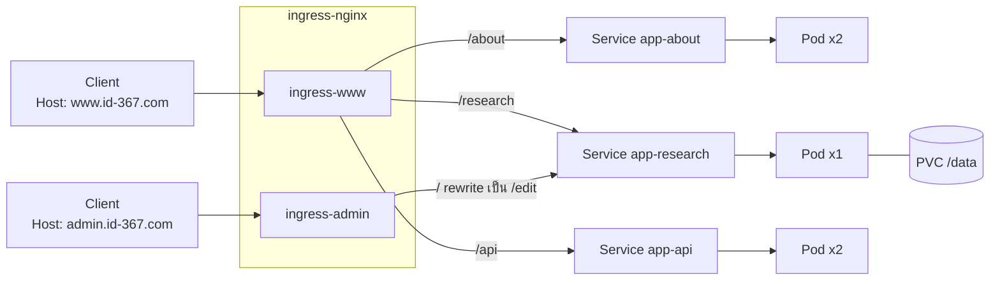

# K8s Ingress Assignment

บริการ 4 ตัวบน Kubernetes เข้าถึงผ่าน ingress-nginx ด้วย domain `id-367.com`

| URL | หน้าที่ | Ingress | Service | จำนวน Pod |
|---|---|---|---|---|
| `www.id-367.com/about` | แสดงรูป ชื่อ และรหัสนักศึกษา | `ingress-www` | `app-about` | 2 |
| `www.id-367.com/research` | แสดงสรุปงานวิจัย | `ingress-www` | `app-research` | 1 (เก็บข้อมูลใน PVC) |
| `www.id-367.com/api/<ข้อความ>` | แสดงข้อความตัวใหญ่กลางจอ | `ingress-www` | `app-api` | 2 |
| `admin.id-367.com` | หน้าแก้ไขสรุปงานวิจัย บันทึกกลับได้ โดย ingress เปลี่ยนทุก request เป็น path `/edit` | `ingress-admin` | `app-research` | ตัวเดียวกับ `/research` |



## สรุปสั้น

ถ้า cluster มี ingress-nginx อยู่แล้ว ใช้คำสั่งชุดนี้ชุดเดียวก็ deploy และทดสอบเสร็จ ใช้ได้เหมือนกันบน macOS, Linux และ Windows (PowerShell หรือ CMD) ไม่ต้องมี bash

```bash
git clone <URL ของ repo นี้>
cd <โฟลเดอร์ที่ clone ได้>
kubectl get ingressclass nginx
kubectl apply -k .
kubectl logs -f job/ingress-check --pod-running-timeout=180s
```

คำสั่งที่สามต้องขึ้นแถว `nginx` ถ้าไม่ขึ้นให้ทำ [ข้อ 1](#1-ติดตั้ง-ingress-nginx) ก่อน คำสั่งสุดท้ายแสดงผลทดสอบ 9 ข้อ ผลที่ถูกต้องคือบรรทัดสุดท้ายเป็น `---- pass=9 fail=0` (บรรทัด `waiting to start: ContainerCreating` ที่ขึ้นก่อนเป็นเรื่องปกติ แค่รอ container เริ่มต้น)

## สิ่งที่ต้องมี

- cluster Kubernetes ที่ `kubectl` ต่อได้ เช่น minikube, Docker Desktop Kubernetes หรือ kubeadm (ตรวจด้วย `kubectl cluster-info`)
- `kubectl` ตัวเดียวก็รันทางหลักได้ทั้งหมด ส่วน script `*.sh` และ `curl` เป็นทางลัดทางเลือกที่ต้องใช้ bash (macOS และ Linux มีอยู่แล้ว ส่วน Windows ให้รันใน Git Bash หรือ WSL)
- ไม่ต้อง build หรือ push image เพราะทุก app ใช้ image สาธารณะ `python:3.12-alpine` ส่วนโค้ดของแต่ละ app เป็นไฟล์ `app.py` ไฟล์เดียวที่ใช้แค่ stdlib และ `kubectl apply -k .` จะสร้าง ConfigMap จากไฟล์ใน repo (ตามที่เขียนใน `kustomization.yaml`) แล้ว mount เข้า pod ให้
- ไม่ต้องแก้อะไรก่อนรัน ชื่อและรหัสนักศึกษาอยู่ใน `config.env` โดเมนอยู่ใน `manifests/40-ingress.yaml` รูปอยู่ที่ `app-about/photo.jpg` และสรุปงานวิจัยอยู่ที่ `app-research/research.seed.md`

## วิธี run

คำสั่งในทุกบล็อกใช้ได้เหมือนกันใน bash, zsh, PowerShell และ CMD ยกเว้นที่ระบุไว้

### 1. ติดตั้ง ingress-nginx

ข้ามข้อนี้ได้ถ้า `kubectl get ingressclass nginx` ขึ้นแถว `nginx` อยู่แล้ว

**ถ้าใช้ minikube**

```bash
minikube addons enable ingress
kubectl wait -n ingress-nginx --for=condition=ready pod -l app.kubernetes.io/component=controller --timeout=240s
```

**ถ้าใช้ Docker Desktop Kubernetes, kubeadm หรือ cluster อื่น**

```bash
kubectl apply -f https://raw.githubusercontent.com/kubernetes/ingress-nginx/controller-v1.12.1/deploy/static/provider/baremetal/deploy.yaml
kubectl wait -n ingress-nginx --for=condition=ready pod -l app.kubernetes.io/component=controller --timeout=240s
```

### 2. Deploy และทดสอบ

```bash
kubectl apply -k .
kubectl logs -f job/ingress-check --pod-running-timeout=180s
```

คำสั่งแรกอ่าน `kustomization.yaml` แล้วสร้างทุกอย่างในครั้งเดียว คือ ConfigMap, PVC, Deployment, Service, Ingress และ Job ทดสอบ ส่วนคำสั่งที่สองดูผลของ Job ซึ่งรันใน cluster เอง รอจน app พร้อมแล้วยิง request ผ่านชื่อ Service ของ ingress-nginx ภายใน cluster จึงไม่ต้องรู้ IP ไม่ต้องตั้ง `port-forward` และไม่ต้องแก้ไฟล์ hosts

ผลที่ถูกต้องคือขึ้น `PASS` ครบ 9 ข้อ และบรรทัดสุดท้ายเป็น `---- pass=9 fail=0` ถ้ามีข้อที่ `FAIL` ให้ดูข้อที่ล้มในผลนั้น คำสั่งรันซ้ำได้โดยไม่ต้องลบของเดิม แต่ Job รันแค่ครั้งเดียวต่อการสร้าง ถ้าจะทดสอบซ้ำให้ลบ Job แล้วสร้างใหม่

```bash
kubectl delete job ingress-check
kubectl apply -k .
kubectl logs -f job/ingress-check --pod-running-timeout=180s
```

ถ้า Service ของ ingress-nginx ไม่ได้ชื่อ `ingress-nginx-controller` ใน namespace `ingress-nginx` (เช่น ติดตั้งด้วย Helm ที่ตั้งชื่อเอง) ให้เพิ่ม env `INGRESS_HOST` ชื่อ Service เต็ม ลงใน `manifests/50-check-job.yaml` ตรงส่วน `env`

ถ้า cluster ไม่มี default StorageClass (ดูจาก `kubectl get storageclass` ว่าไม่มีตัวที่ต่อท้ายว่า `(default)` เช่น kubeadm) PVC จะค้างสถานะ Pending ให้สร้าง hostPath PV เพิ่มด้วยคำสั่งนี้ แล้วรอสักครู่

```bash
kubectl apply -f manifests/storage-hostpath.yaml
```

ถ้าใช้ bash จะใช้ทางลัด `./deploy.sh` แทนก็ได้ script นี้ตรวจว่ามี ingress-nginx สร้าง hostPath PV ให้เองเมื่อไม่มี default StorageClass แล้วรัน `kubectl apply -k .` และรอ pod พร้อม

### 3. เปิดดูในเบราว์เซอร์ (ไม่บังคับ)

ingress เลือก app จากชื่อโดเมนที่เบราว์เซอร์ส่งมา เปิด `localhost` หรือ IP ตรง ๆ จะได้ 404 จึงต้องให้เครื่องรู้ว่า `www.id-367.com` และ `admin.id-367.com` คือเครื่องนี้ วิธีนี้ใช้ได้กับทุก cluster และทุกระบบ

1. เปิดเทอร์มินัลหนึ่งรันคำสั่งนี้ค้างไว้ (ถ้าพอร์ต 8080 ถูกใช้อยู่ ให้เปลี่ยนเลขตัวแรก เช่น `8081:80` แล้วใช้เลขนั้นใน URL)
   ```bash
   kubectl -n ingress-nginx port-forward svc/ingress-nginx-controller 8080:80
   ```
2. เพิ่มบรรทัด `127.0.0.1 www.id-367.com admin.id-367.com` ลงในไฟล์ hosts ของระบบที่ใช้เปิดเบราว์เซอร์ ต้องใช้สิทธิ์ admin

   **macOS และ Linux** ไฟล์คือ `/etc/hosts`
   ```bash
   echo "127.0.0.1 www.id-367.com admin.id-367.com" | sudo tee -a /etc/hosts
   ```
   **Windows** ไฟล์คือ `C:\Windows\System32\drivers\etc\hosts` เปิด PowerShell แบบ Run as administrator แล้วรัน
   ```powershell
   Add-Content -Path "C:\Windows\System32\drivers\etc\hosts" -Value "`n127.0.0.1 www.id-367.com admin.id-367.com"
   ```
   ถ้าเปิดเบราว์เซอร์บน Windows ต้องแก้ไฟล์ hosts ของ Windows ข้างบน การแก้ `/etc/hosts` ใน WSL หรือ Git Bash ไม่มีผลกับเบราว์เซอร์
3. เปิด URL เหล่านี้
   - `http://www.id-367.com:8080/about`
   - `http://www.id-367.com:8080/research`
   - `http://www.id-367.com:8080/api/สวัสดี`
   - `http://admin.id-367.com:8080/`

เมื่อดูเสร็จให้กด `Ctrl+C` ที่เทอร์มินัล `port-forward` และลบบรรทัดที่เพิ่มออกจากไฟล์ hosts ด้วย editor ที่เปิดด้วยสิทธิ์ admin

### เลิกใช้

```bash
kubectl delete -k .
```

คำสั่งนี้ลบเฉพาะ resource ของ assignment นี้ (รวม Job ทดสอบ) ไม่ลบ ingress-nginx ถ้าเคยสร้าง hostPath PV ในข้อ 2 ให้ลบด้วย `kubectl delete pv -l app.kubernetes.io/part-of=k8s-ingress-assignment` ถ้าใช้ bash จะใช้ `./teardown.sh` แทนก็ได้ ซึ่งทำทั้งสองอย่างให้

ถ้าแก้โค้ด app แล้วอยากให้ pod ใช้โค้ดใหม่ ให้รัน `kubectl apply -k .` ตามด้วยคำสั่งนี้ (ใน bash ใช้ `./deploy.sh --restart` แทนได้)

```bash
kubectl rollout restart deployment -l app.kubernetes.io/part-of=k8s-ingress-assignment
```

## ทางเลือกอื่น

### เข้า ingress โดยไม่ใช้ port-forward

ถ้า cluster เปิดทางเข้า ingress ให้เครื่องของคุณอยู่แล้ว จะใช้ IP และพอร์ตนั้นแทน `127.0.0.1:8080` ก็ได้ ใช้ได้ทั้งตอนตั้งไฟล์ hosts (เปลี่ยน `127.0.0.1` เป็น IP นั้น) และตอนทดสอบจากภายนอกด้วย bash

- `INGRESS_IP` คือ IP ของเครื่องที่รับ request เข้า ingress-nginx เมื่อมองจากเครื่องที่คุณพิมพ์คำสั่ง
- `INGRESS_PORT` คือพอร์ตของเครื่องนั้น

เลือกแถวที่ตรงกับ cluster ของคุณ

| cluster ของคุณ | INGRESS_IP | INGRESS_PORT |
|---|---|---|
| Docker Desktop Kubernetes (ล็อก NodePort ตามหัวข้อ load balancer ด้านล่างแล้ว) | `127.0.0.1` | `31080` |
| minikube ที่เข้า IP ของ node ได้ | ผลของ `minikube ip` | เลขหลัง `80:` ในคอลัมน์ PORT(S) ของ `kubectl get svc -n ingress-nginx ingress-nginx-controller` เช่น `80:31080/TCP` คือ `31080` |
| kubeadm, VM หรือเครื่องจริง | คอลัมน์ INTERNAL-IP ของ `kubectl get nodes -o wide` (node ไหนก็ได้) ใช้ได้เมื่อเครื่องที่รันต่อ IP นั้นถึง | `31080` ถ้าล็อก NodePort ตามหัวข้อ load balancer ด้านล่างแล้ว |
| มี external load balancer | IP ของเครื่อง LB | `80` |
| Service ของ ingress-nginx เป็นชนิด LoadBalancer (เช่น cloud หรือ MetalLB) | คอลัมน์ EXTERNAL-IP ของ `kubectl get svc -n ingress-nginx ingress-nginx-controller` | `80` |

ลองตรวจสองค่านี้ด้วยคำสั่งเดียว ถ้าได้ `200` แปลว่าเข้า ingress ได้ ใน PowerShell บน Windows ให้พิมพ์ `curl.exe` แทน `curl` เพราะ `curl` ในนั้นเป็นชื่อย่อของคำสั่งอื่น

```bash
curl -s -o /dev/null -w "%{http_code}\n" -H "Host: www.id-367.com" http://<INGRESS_IP>:<INGRESS_PORT>/about
```

ถ้าได้ `000` หรือค้างจนหมดเวลา แปลว่าเครื่องที่รันต่อ IP หรือพอร์ตนั้นไม่ถึง ให้ลองแถวอื่นในตาราง เพราะ IP ใน `kubectl get nodes` บางแบบอยู่ในเครือข่ายภายใน เช่น Docker Desktop ที่ได้ `192.168.65.3` ซึ่งเข้าจากเครื่องที่รันไม่ได้ ต้องใช้ `127.0.0.1` แทน

ถ้ามี bash และ `curl` จะรันทดสอบแบบเดียวกับ Job จากเครื่องของคุณได้ โดยใช้ค่าที่หาได้ข้างบน script นี้บันทึกผลไว้ที่ `tests/results.txt`

```bash
INGRESS_IP=<INGRESS_IP> INGRESS_PORT=<INGRESS_PORT> ./tests/check.sh
```

### กรณีมี external load balancer (nginx บน VM แยก)

client เข้า LB ที่พอร์ต 80 แล้ว LB ส่งต่อไปที่ NodePort 31080 ของ worker จากนั้น ingress-nginx ส่งต่อให้ Service และ Pod

ขั้นแรกให้ล็อก NodePort ของ http ไว้ที่ 31080 เพื่อให้ LB ชี้พอร์ตได้ตรงกัน (ทำหลังติดตั้งตามข้อ 1 ถ้าเป็น minikube ให้ตรวจพอร์ตจริงด้วย `kubectl get svc -n ingress-nginx` แล้วใช้เลขนั้นแทน 31080)

```bash
kubectl -n ingress-nginx patch svc ingress-nginx-controller -p '{"spec":{"ports":[{"port":80,"nodePort":31080}]}}'
kubectl get svc -n ingress-nginx
```

คำสั่งหลังต้องเห็น `80:31080/TCP` ในคอลัมน์ PORT(S) จากนั้น deploy ตามข้อ 2 แล้วตั้งค่า LB ดังนี้

1. ส่งไฟล์ [`lb/ingress.conf`](lb/ingress.conf) จากเครื่องที่ clone repo ไปยัง LB (`<user>` คือ user ที่ ssh เข้า LB ได้)
   ```bash
   scp lb/ingress.conf <user>@<IP ของ LB>:/tmp/ingress.conf
   ```
2. ssh เข้า LB แล้วย้ายไฟล์ไปไว้ในโฟลเดอร์ที่ nginx อ่าน
   ```bash
   ssh <user>@<IP ของ LB>
   sudo mv /tmp/ingress.conf /etc/nginx/sites-enabled/ingress.conf
   ```
3. เปิดไฟล์แล้วแก้ `server_name` (ในไฟล์ตั้งเป็น `www.id-367.com admin.id-367.com`) ให้ตรงกับ domain ของคุณ และแก้ IP ของ worker ใน `upstream` ให้เป็นของคุณ ส่วนพอร์ต 31080 ไม่ต้องแก้ เพราะตรงกับที่ patch NodePort ไว้ข้างบน
   ```bash
   sudo nano /etc/nginx/sites-enabled/ingress.conf
   ```
4. ตรวจ config แล้ว reload nginx ถ้า `nginx -t` แจ้ง error ให้แก้ไฟล์ให้ผ่านก่อน
   ```bash
   sudo nginx -t && sudo systemctl reload nginx
   ```
5. ที่เครื่องซึ่งใช้เปิดเว็บ ให้เพิ่มบรรทัด `<IP ของ LB> www.id-367.com admin.id-367.com` ในไฟล์ hosts (วิธีเพิ่มดูที่ข้อ 3 ของหัวข้อ "วิธี run") แล้วเปิด `http://www.id-367.com/about` ได้เลย ไม่ต้องใส่พอร์ตเพราะ LB ฟังพอร์ต 80
6. ทดสอบด้วย `INGRESS_IP=<IP ของ LB> INGRESS_PORT=80 ./tests/check.sh`

ถ้าใช้ `scp` ไม่ได้ ให้รัน `sudo nano /etc/nginx/sites-enabled/ingress.conf` บน LB แล้ววางเนื้อหาของไฟล์ลงไปเองแทนรายการที่ 1 และ 2 ด้านบน

## ตรวจสอบด้วยมือ

```bash
kubectl get deploy,po,svc,ingress,pvc
kubectl describe ingress ingress-www ingress-admin
kubectl get endpoints app-about app-research app-api
kubectl logs -n ingress-nginx -l app.kubernetes.io/name=ingress-nginx --tail=20
```

## ปัญหาที่พบบ่อย

| อาการ | สาเหตุและวิธีแก้ |
|---|---|
| `deploy.sh` แจ้งว่ายังไม่มี IngressClass `nginx` หรือ Ingress ไม่มีค่า ADDRESS | ยังไม่ได้ติดตั้ง ingress-nginx ให้ทำข้อ 1 |
| PVC `app-research-data` ค้าง Pending | cluster ไม่มี default StorageClass ให้ทำตามข้อ 2 (`kubectl apply -f manifests/storage-hostpath.yaml`) ดูสาเหตุเพิ่มด้วย `kubectl describe pvc app-research-data` |
| Job `ingress-check` ล้ม (`pass` ไม่ครบ 9) | ดูข้อที่ `FAIL` ในผลของ `kubectl logs job/ingress-check` แล้วตรวจ `kubectl get po,ingress` ถ้ามี ingress-nginx ตัวอื่นที่ชื่อ Service ต่างกัน ดูข้อ 2 |
| เปิด URL แล้วได้ 404 จาก nginx | ส่งชื่อโดเมนไม่ตรง ต้องเข้าด้วย `www.id-367.com` หรือ `admin.id-367.com` ไม่ใช่ `localhost` หรือ IP |
| `check.sh` ได้ status `000` หรือ connection refused | IP หรือพอร์ตผิด หรือ `port-forward` ไม่ได้เปิดค้างไว้ |
