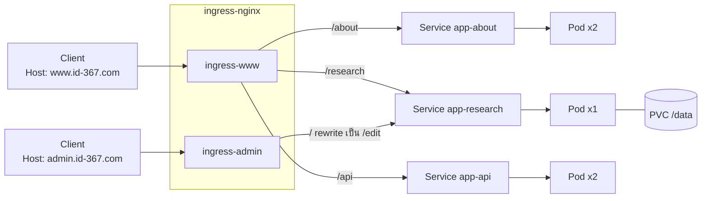

# K8s Ingress Assignment

บริการ 4 ตัวบน Kubernetes เข้าถึงผ่าน ingress-nginx ด้วย domain `id-367.com` ตามเลข 3 ตัวท้ายรหัสนักศึกษาที่ตั้งไว้ใน `config.env`

| URL | หน้าที่ | Ingress | Service | จำนวน Pod |
|---|---|---|---|---|
| `www.id-367.com/about` | แสดงรูป ชื่อ และรหัสนักศึกษา | `ingress-www` | `app-about` | 2 |
| `www.id-367.com/research` | แสดงสรุปงานวิจัย | `ingress-www` | `app-research` | 1 (เก็บข้อมูลใน PVC) |
| `www.id-367.com/api/<ข้อความ>` | แสดงข้อความตัวใหญ่กลางจอ | `ingress-www` | `app-api` | 2 |
| `admin.id-367.com` | หน้าแก้ไขสรุปงานวิจัย บันทึกกลับได้ โดย ingress เปลี่ยนทุก request เป็น path `/edit` | `ingress-admin` | `app-research` | ตัวเดียวกับ `/research` |



## สิ่งที่ต้องมี

- cluster Kubernetes ที่ `kubectl` ต่อได้ เช่น minikube, Docker Desktop Kubernetes หรือ kubeadm (ตรวจด้วย `kubectl cluster-info`)
- `bash` และ `curl`
- ไม่ต้อง build หรือ push image เพราะทุก app ใช้ image สาธารณะ `python:3.12-alpine` ส่วนโค้ดของแต่ละ app เป็นไฟล์ `app.py` ไฟล์เดียวที่ใช้แค่ stdlib และ `deploy.sh` จะสร้าง ConfigMap จากไฟล์ใน repo แล้ว mount เข้า pod ให้
- ไม่ต้องแก้อะไรก่อนรัน ชื่อ รหัสนักศึกษา และเลข 3 ตัวท้ายตั้งไว้ใน `config.env` แล้ว รูปอยู่ที่ `app-about/photo.jpg` และสรุปงานวิจัยอยู่ที่ `app-research/research.seed.md`

## วิธี run ตั้งแต่ต้นจนจบ

### 0. Clone แล้วเข้าโฟลเดอร์

```bash
git clone <URL ของ repo นี้>
cd <โฟลเดอร์ที่ clone ได้>
kubectl config current-context        # ตรวจว่าชี้ไปที่ cluster ที่ต้องการ
```

### 1. ติดตั้ง ingress-nginx

ตรวจก่อนว่ามีอยู่แล้วหรือยัง ถ้าขึ้น `nginx` ก็ข้ามไปข้อ 2 ได้เลย

```bash
kubectl get ingressclass nginx
```

**ถ้าใช้ minikube**

```bash
minikube addons enable ingress
kubectl wait -n ingress-nginx --for=condition=ready pod -l app.kubernetes.io/component=controller --timeout=240s
```

**ถ้าใช้ Docker Desktop Kubernetes, kubeadm หรือ cluster อื่น** ให้ติดตั้งจาก manifest แบบ bare metal แล้วล็อก NodePort ของ http ไว้ที่ 31080 เพื่อให้ข้อ 3 และ load balancer ชี้พอร์ตได้ตรงกัน

```bash
kubectl apply -f https://raw.githubusercontent.com/kubernetes/ingress-nginx/controller-v1.12.1/deploy/static/provider/baremetal/deploy.yaml
kubectl wait -n ingress-nginx --for=condition=ready pod -l app.kubernetes.io/component=controller --timeout=240s
kubectl -n ingress-nginx patch svc ingress-nginx-controller -p '{"spec":{"ports":[{"port":80,"nodePort":31080}]}}'
kubectl get svc -n ingress-nginx      # ต้องเห็น 80:31080/TCP
```

### 2. Deploy

```bash
./deploy.sh
```

script จะสร้าง ConfigMap, PVC, Deployment, Service และ Ingress ทั้งหมด แล้วรอจน pod ของทั้ง 3 app พร้อม ถ้าจบโดยไม่มี `ERROR` ก็แปลว่า deploy ผ่าน และรันซ้ำได้เลยไม่ต้องลบของเดิมก่อน

ถ้า cluster ไม่มี default StorageClass (เช่น kubeadm) script จะสร้าง hostPath PV ให้เอง

### 3. ทดสอบอัตโนมัติ

`tests/check.sh` ยิง request ไปที่ ingress ด้วย `curl --resolve` จึงไม่ต้องแก้ `/etc/hosts` ก่อน ต้องบอก IP และพอร์ตที่เข้า ingress ได้จากเครื่องที่รัน ซึ่งขึ้นกับชนิดของ cluster

| cluster | คำสั่ง |
|---|---|
| Docker Desktop Kubernetes | `INGRESS_IP=127.0.0.1 INGRESS_PORT=31080 ./tests/check.sh` |
| minikube บน Mac (Docker driver) | เปิดเทอร์มินัลหนึ่งไว้รัน `kubectl -n ingress-nginx port-forward svc/ingress-nginx-controller 8080:80` ค้างไว้ แล้วในอีกเทอร์มินัลรัน `INGRESS_IP=127.0.0.1 INGRESS_PORT=8080 ./tests/check.sh` |
| VM หรือเครื่องที่เข้า IP ของ node ได้ตรง ๆ | `INGRESS_IP=<IP ของ node> INGRESS_PORT=31080 ./tests/check.sh` |

บน Mac ที่ใช้ minikube แบบ Docker driver เข้า `minikube ip` ตรง ๆ ไม่ได้ จึงต้องใช้ `port-forward`

ผลที่ถูกต้องคือขึ้น `PASS` ครบ 9 ข้อ และบรรทัดสุดท้ายเป็น `---- pass=9 fail=0` script จะบันทึกผลไว้ที่ `tests/results.txt` และจบด้วย exit code 0 เมื่อผ่านทั้งหมด

### 4. เปิดดูในเบราว์เซอร์

ingress เลือก app จากชื่อโดเมนที่เบราว์เซอร์ส่งมา เปิด `localhost` หรือ IP ตรง ๆ จะได้ 404 จึงต้องให้เครื่องรู้ว่า `www.id-367.com` และ `admin.id-367.com` คือเครื่องนี้

```bash
echo "<INGRESS_IP> www.id-367.com admin.id-367.com" | sudo tee -a /etc/hosts
```

ถ้าเข้าผ่าน Docker Desktop หรือ `port-forward` ให้ใช้ `127.0.0.1` เป็น `<INGRESS_IP>` แล้วเปิด URL ด้วยพอร์ตเดียวกับที่ใช้ในข้อ 3 คือ 31080 หรือ 8080 ส่วนถ้าเข้า ingress ที่พอร์ต 80 ตรง ๆ ไม่ต้องใส่พอร์ตใน URL

- `http://www.id-367.com:<พอร์ต>/about`
- `http://www.id-367.com:<พอร์ต>/research`
- `http://www.id-367.com:<พอร์ต>/api/สวัสดี`
- `http://admin.id-367.com:<พอร์ต>/`

เมื่อดูเสร็จให้ลบบรรทัดที่เพิ่มออกจาก `/etc/hosts`

### 5. เลิกใช้

```bash
./teardown.sh
```

คำสั่งนี้ลบเฉพาะ resource ของ assignment นี้ ไม่ลบ ingress-nginx ถ้าแก้โค้ด app แล้วอยากให้ pod ใช้โค้ดใหม่ ให้รัน `./deploy.sh --restart`

## กรณีมี external load balancer (nginx บน VM แยก)

client เข้า LB ที่พอร์ต 80 แล้ว LB ส่งต่อไปที่ NodePort 31080 ของ worker จากนั้น ingress-nginx ส่งต่อให้ Service และ Pod

ทำข้อ 1 ด้วยวิธีที่ล็อก NodePort 31080 ก่อน แล้ว deploy ตามข้อ 2 จากนั้นตั้งค่า LB ดังนี้

1. ส่งไฟล์ [`lb/ingress.conf`](lb/ingress.conf) จากเครื่องที่ clone repo ไปยัง LB (`<user>` คือ user ที่ ssh เข้า LB ได้)
   ```bash
   scp lb/ingress.conf <user>@<IP ของ LB>:/tmp/ingress.conf
   ```
2. ssh เข้า LB แล้วย้ายไฟล์ไปไว้ในโฟลเดอร์ที่ nginx อ่าน
   ```bash
   ssh <user>@<IP ของ LB>
   sudo mv /tmp/ingress.conf /etc/nginx/sites-enabled/ingress.conf
   ```
3. เปิดไฟล์แล้วแก้ `server_name` (ในไฟล์ตั้งเป็น `www.id-367.com admin.id-367.com`) ให้ตรงกับ domain ของคุณ และแก้ IP ของ worker ใน `upstream` ให้เป็นของคุณ ส่วนพอร์ต 31080 ไม่ต้องแก้ เพราะตรงกับที่ patch NodePort ไว้ในข้อ 1
   ```bash
   sudo nano /etc/nginx/sites-enabled/ingress.conf
   ```
4. ตรวจ config แล้ว reload nginx ถ้า `nginx -t` แจ้ง error ให้แก้ไฟล์ให้ผ่านก่อน
   ```bash
   sudo nginx -t && sudo systemctl reload nginx
   ```
5. ที่เครื่องซึ่งใช้เปิดเว็บ ให้เพิ่มบรรทัด `<IP ของ LB> www.id-367.com admin.id-367.com` ใน `/etc/hosts` แล้วเปิด `http://www.id-367.com/about` ได้เลย ไม่ต้องใส่พอร์ตเพราะ LB ฟังพอร์ต 80
6. ทดสอบด้วย `INGRESS_IP=<IP ของ LB> INGRESS_PORT=80 ./tests/check.sh`

ถ้าใช้ `scp` ไม่ได้ ให้รัน `sudo nano /etc/nginx/sites-enabled/ingress.conf` บน LB แล้ววางเนื้อหาของไฟล์ลงไปเองแทนรายการที่ 1 และ 2 ด้านบน

## ตรวจสอบด้วยมือ

```bash
kubectl get deploy,po,svc,ingress,pvc
kubectl describe ingress ingress-www ingress-admin
kubectl get endpoints app-about app-research app-api
kubectl logs -n ingress-nginx -l app.kubernetes.io/name=ingress-nginx --tail=20
curl -H "Host: www.id-367.com" http://<INGRESS_IP>:<พอร์ต>/api/hello
```

## ปัญหาที่พบบ่อย

| อาการ | สาเหตุและวิธีแก้ |
|---|---|
| `deploy.sh` แจ้งว่ายังไม่มี IngressClass `nginx` | ยังไม่ได้ติดตั้ง ingress-nginx ให้ทำข้อ 1 |
| เปิด URL แล้วได้ 404 จาก nginx | ส่งชื่อโดเมนไม่ตรง ต้องเข้าด้วย `www.id-367.com` หรือ `admin.id-367.com` ไม่ใช่ `localhost` หรือ IP |
| `check.sh` ได้ status `000` หรือ connection refused | IP หรือพอร์ตผิด หรือ `port-forward` ไม่ได้เปิดค้างไว้ |
| `check.sh` ล้มทันทีหลัง deploy | pod อาจยังไม่พร้อม ตรวจด้วย `kubectl get po` แล้วรันซ้ำ |

## ข้อจำกัดที่รู้

- หน้า admin ไม่มี authentication (โจทย์ไม่ได้ขอ) ถ้าใช้งานจริงควรเพิ่ม basic-auth annotation ของ ingress-nginx
- ไม่มี HTTPS/TLS (โจทย์ไม่ได้ขอ)
- โค้ด app อยู่ใน ConfigMap ซึ่งจำกัดขนาด 1 MiB ต่อ ConfigMap จึงเหมาะกับ app เล็กแบบนี้ แต่ไม่ใช่แนวทางที่ควรใช้ใน production
- `app-research` ต้องมี 1 replica เพราะเก็บข้อมูลใน PVC แบบ ReadWriteOnce
