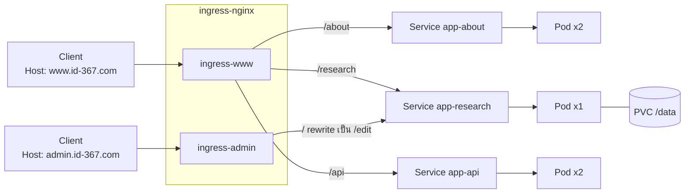

# K8s Ingress Assignment

บริการ 4 ตัวบน Kubernetes เข้าถึงผ่าน ingress-nginx ด้วย domain `id-367.com`

| URL | หน้าที่ | Ingress | Service | จำนวน Pod |
|---|---|---|---|---|
| `www.id-367.com/about` | แสดงรูป ชื่อ และรหัสนักศึกษา | `ingress-www` | `app-about` | 2 |
| `www.id-367.com/research` | แสดงสรุปงานวิจัย | `ingress-www` | `app-research` | 1 (เก็บข้อมูลใน PVC) |
| `www.id-367.com/api/<ข้อความ>` | แสดงข้อความตัวใหญ่กลางจอ | `ingress-www` | `app-api` | 2 |
| `admin.id-367.com` | หน้าแก้ไขสรุปงานวิจัย บันทึกกลับได้ โดย ingress เปลี่ยนทุก request เป็น path `/edit` | `ingress-admin` | `app-research` | ตัวเดียวกับ `/research` |



## สิ่งที่ต้องมี

- cluster Kubernetes ที่ `kubectl` ต่อได้ เช่น minikube, Docker Desktop Kubernetes หรือ kubeadm (ตรวจด้วย `kubectl cluster-info`)
- ทุกขั้นตอนหลักใช้แค่ `kubectl` จึงรันได้เหมือนกันบน macOS, Linux และ Windows (PowerShell หรือ CMD) ไม่ต้องมี bash ส่วน script `*.sh` กับ `curl` เป็นทางลัดทางเลือก ต้องใช้ bash (macOS และ Linux มีอยู่แล้ว ส่วน Windows ให้รันใน Git Bash หรือ WSL)
- ไม่ต้อง build หรือ push image เพราะทุก app ใช้ image สาธารณะ `python:3.12-alpine` ส่วนโค้ดของแต่ละ app เป็นไฟล์ `app.py` ไฟล์เดียวที่ใช้แค่ stdlib และ `kubectl apply -k .` จะสร้าง ConfigMap จากไฟล์ใน repo (ตามที่เขียนใน `kustomization.yaml`) แล้ว mount เข้า pod ให้
- ไม่ต้องแก้อะไรก่อนรัน ชื่อและรหัสนักศึกษาอยู่ใน `config.env` โดเมนอยู่ใน `manifests/40-ingress.yaml` รูปอยู่ที่ `app-about/photo.jpg` และสรุปงานวิจัยอยู่ที่ `app-research/research.seed.md`

## วิธี run ตั้งแต่ต้นจนจบ

คำสั่งในทุกบล็อกด้านล่างใช้ได้เหมือนกันใน bash, zsh, PowerShell และ CMD ยกเว้นที่ระบุไว้

### 0. Clone แล้วเข้าโฟลเดอร์

```bash
git clone <URL ของ repo นี้>
cd <โฟลเดอร์ที่ clone ได้>
kubectl config current-context
```

คำสั่งสุดท้ายแสดงชื่อ cluster ที่ `kubectl` ใช้อยู่ ให้ตรวจว่าเป็นตัวที่ต้องการ

### 1. ติดตั้ง ingress-nginx

ตรวจก่อนว่ามีอยู่แล้วหรือยัง ถ้าขึ้น `nginx` ก็ข้ามไปข้อ 2 ได้เลย

```bash
kubectl get ingressclass nginx
```

**ถ้าใช้ minikube**

```bash
minikube addons enable ingress
kubectl wait -n ingress-nginx --for=condition=ready pod -l app.kubernetes.io/component=controller --timeout=240s
```

**ถ้าใช้ Docker Desktop Kubernetes, kubeadm หรือ cluster อื่น** ให้ติดตั้งจาก manifest แบบ bare metal แล้วล็อก NodePort ของ http ไว้ที่ 31080 เพื่อให้ข้อ 4 และ load balancer ชี้พอร์ตได้ตรงกัน

```bash
kubectl apply -f https://raw.githubusercontent.com/kubernetes/ingress-nginx/controller-v1.12.1/deploy/static/provider/baremetal/deploy.yaml
kubectl wait -n ingress-nginx --for=condition=ready pod -l app.kubernetes.io/component=controller --timeout=240s
kubectl -n ingress-nginx patch svc ingress-nginx-controller -p '{"spec":{"ports":[{"port":80,"nodePort":31080}]}}'
kubectl get svc -n ingress-nginx
```

คำสั่งสุดท้ายต้องเห็น `80:31080/TCP` ในคอลัมน์ PORT(S)

### 2. Deploy

```bash
kubectl apply -k .
kubectl wait --for=condition=available deployment -l app.kubernetes.io/part-of=k8s-ingress-assignment --timeout=180s
```

คำสั่งแรกอ่าน `kustomization.yaml` แล้วสร้าง ConfigMap, PVC, Deployment, Service และ Ingress ทั้งหมดในครั้งเดียว คำสั่งที่สองรอจน pod ของทั้ง 3 app พร้อม ถ้าจบโดยไม่มี error ก็แปลว่า deploy ผ่าน และรันซ้ำได้เลยไม่ต้องลบของเดิมก่อน

ถ้า cluster ไม่มี default StorageClass (ดูจาก `kubectl get storageclass` ว่าไม่มีตัวที่ต่อท้ายว่า `(default)` เช่น kubeadm) PVC จะค้างสถานะ Pending ให้สร้าง hostPath PV เพิ่มด้วยคำสั่งนี้

```bash
kubectl apply -f manifests/storage-hostpath.yaml
```

ถ้าใช้ bash จะใช้ทางลัด `./deploy.sh` แทนก็ได้ script นี้ตรวจว่ามี ingress-nginx แล้วสร้าง hostPath PV ให้เองเมื่อไม่มี default StorageClass จากนั้นรัน `kubectl apply -k .` และรอ pod พร้อม

### 3. ทดสอบอัตโนมัติ

ทดสอบด้วย Job ที่รันใน cluster เอง ยิง request ผ่านชื่อ Service ของ ingress-nginx ภายใน cluster จึงไม่ต้องรู้ IP ไม่ต้องตั้ง `port-forward` และไม่ต้องแก้ไฟล์ hosts

```bash
kubectl delete -k tests --ignore-not-found
kubectl apply -k tests
kubectl wait --for=condition=complete job/ingress-check --timeout=180s
kubectl logs job/ingress-check
```

ผลที่ถูกต้องคือ `logs` ขึ้น `PASS` ครบ 9 ข้อ บรรทัดสุดท้ายเป็น `---- pass=9 fail=0` และ Job อยู่ในสถานะ Complete (ดูด้วย `kubectl get job ingress-check`) ถ้ามีข้อที่ `FAIL` Job จะเป็น Failed และคำสั่ง `wait` จะรอจนหมดเวลา ให้ดูข้อที่ล้มจาก `kubectl logs job/ingress-check`

ถ้า Service ของ ingress-nginx ไม่ได้ชื่อ `ingress-nginx-controller` ใน namespace `ingress-nginx` (เช่น ติดตั้งด้วย Helm ที่ตั้งชื่อเอง) ให้เพิ่ม env `INGRESS_HOST` ชื่อ Service เต็ม ลงใน `tests/check-job.yaml` ตรงส่วน `env`

### 4. เปิดดูในเบราว์เซอร์

ingress เลือก app จากชื่อโดเมนที่เบราว์เซอร์ส่งมา เปิด `localhost` หรือ IP ตรง ๆ จะได้ 404 จึงต้องให้เครื่องรู้ว่า `www.id-367.com` และ `admin.id-367.com` คือเครื่องนี้ ต้องหา IP และพอร์ตที่เข้า ingress ได้ก่อน

**หา `INGRESS_IP` และ `INGRESS_PORT`**

- `INGRESS_IP` คือ IP ของเครื่องที่รับ request เข้า ingress-nginx เมื่อมองจากเครื่องที่คุณพิมพ์คำสั่ง
- `INGRESS_PORT` คือพอร์ตของเครื่องนั้น

ทั้งสองค่าขึ้นกับว่า cluster เปิดทางเข้าไว้อย่างไร ให้เลือกแถวที่ตรงกับ cluster ของคุณ

| cluster ของคุณ | INGRESS_IP | INGRESS_PORT |
|---|---|---|
| Docker Desktop Kubernetes | `127.0.0.1` | `31080` |
| minikube ที่เข้า IP ของ node ไม่ได้จากเครื่องที่รัน (เช่น Docker driver) | `127.0.0.1` | `8080` (ต้องเปิด `port-forward` ตามคำสั่งด้านล่างตาราง) |
| minikube ที่เข้า IP ของ node ได้ | ผลของ `minikube ip` | เลขหลัง `80:` ในคอลัมน์ PORT(S) ของ `kubectl get svc -n ingress-nginx ingress-nginx-controller` เช่น `80:31080/TCP` คือ `31080` |
| kubeadm, VM หรือเครื่องจริง | คอลัมน์ INTERNAL-IP ของ `kubectl get nodes -o wide` (node ไหนก็ได้) ใช้ได้เมื่อเครื่องที่รันต่อ IP นั้นถึง | `31080` ถ้าทำข้อ 1 ตามที่เขียนไว้ |
| มี external load balancer | IP ของเครื่อง LB | `80` |
| Service ของ ingress-nginx เป็นชนิด LoadBalancer (เช่น cloud หรือ MetalLB) | คอลัมน์ EXTERNAL-IP ของ `kubectl get svc -n ingress-nginx ingress-nginx-controller` | `80` |

ถ้าใช้แถวที่สอง ให้เปิดเทอร์มินัลหนึ่งรันคำสั่งนี้ค้างไว้ เพราะ node อยู่ใน container ของ Docker จึงเข้า `minikube ip` ตรง ๆ ไม่ได้

```bash
kubectl -n ingress-nginx port-forward svc/ingress-nginx-controller 8080:80
```

ลองตรวจสองค่านี้ด้วยคำสั่งเดียว ถ้าได้ `200` แปลว่าเข้า ingress ได้ (ต้อง deploy ตามข้อ 2 แล้ว) ใน PowerShell บน Windows ให้พิมพ์ `curl.exe` แทน `curl` เพราะ `curl` ในนั้นเป็นชื่อย่อของคำสั่งอื่น

```bash
curl -s -o /dev/null -w "%{http_code}\n" -H "Host: www.id-367.com" http://<INGRESS_IP>:<INGRESS_PORT>/about
```

ถ้าได้ `000` หรือค้างจนหมดเวลา แปลว่าเครื่องที่รันต่อ IP หรือพอร์ตนั้นไม่ถึง ให้ลองแถวอื่นในตาราง เพราะ IP ใน `kubectl get nodes` บางแบบอยู่ในเครือข่ายภายใน เช่น Docker Desktop ที่ได้ `192.168.65.3` ซึ่งเข้าจากเครื่องที่รันไม่ได้ ต้องใช้ `127.0.0.1` แทน

**เพิ่มชื่อโดเมนลงไฟล์ hosts**

เพิ่มบรรทัด `<INGRESS_IP> www.id-367.com admin.id-367.com` ลงในไฟล์ hosts ของระบบที่ใช้เปิดเบราว์เซอร์ โดย `<INGRESS_IP>` คือค่าที่หาได้ข้างบน และต้องใช้สิทธิ์ admin

**macOS และ Linux** ไฟล์คือ `/etc/hosts`

```bash
echo "<INGRESS_IP> www.id-367.com admin.id-367.com" | sudo tee -a /etc/hosts
```

**Windows** ไฟล์คือ `C:\Windows\System32\drivers\etc\hosts` เปิด PowerShell แบบ Run as administrator แล้วรัน

```powershell
Add-Content -Path "C:\Windows\System32\drivers\etc\hosts" -Value "`n<INGRESS_IP> www.id-367.com admin.id-367.com"
```

ถ้าเปิดเบราว์เซอร์บน Windows ต้องแก้ไฟล์ hosts ของ Windows ข้างบน การแก้ `/etc/hosts` ใน WSL หรือ Git Bash ไม่มีผลกับเบราว์เซอร์

จากนั้นเปิด URL ด้านล่าง โดยใส่ `<พอร์ต>` เป็นค่า `INGRESS_PORT` ที่หาได้ข้างบน ถ้าพอร์ตเป็น 80 ไม่ต้องใส่พอร์ตใน URL

- `http://www.id-367.com:<พอร์ต>/about`
- `http://www.id-367.com:<พอร์ต>/research`
- `http://www.id-367.com:<พอร์ต>/api/สวัสดี`
- `http://admin.id-367.com:<พอร์ต>/`

เมื่อดูเสร็จให้ลบบรรทัดที่เพิ่มออกจากไฟล์ hosts ด้วย editor ที่เปิดด้วยสิทธิ์ admin

**ทดสอบจากภายนอกด้วย bash (ทางเลือก)** ถ้ามี bash และ `curl` จะรันทดสอบแบบเดียวกับข้อ 3 จากเครื่องของคุณได้ โดยใช้ค่าที่หาได้ข้างบน script นี้บันทึกผลไว้ที่ `tests/results.txt`

```bash
INGRESS_IP=<INGRESS_IP> INGRESS_PORT=<INGRESS_PORT> ./tests/check.sh
```

### 5. เลิกใช้

```bash
kubectl delete -k tests --ignore-not-found
kubectl delete -k .
kubectl delete pv -l app.kubernetes.io/part-of=k8s-ingress-assignment --ignore-not-found
```

คำสั่งนี้ลบเฉพาะ resource ของ assignment นี้ ไม่ลบ ingress-nginx บรรทัดสุดท้ายใช้เฉพาะเมื่อเคยสร้าง hostPath PV ในข้อ 2 ถ้าใช้ bash จะใช้ `./teardown.sh` แทนก็ได้

ถ้าแก้โค้ด app แล้วอยากให้ pod ใช้โค้ดใหม่ ให้รัน `kubectl apply -k .` ตามด้วยคำสั่งนี้ (ใน bash ใช้ `./deploy.sh --restart` แทนได้)

```bash
kubectl rollout restart deployment -l app.kubernetes.io/part-of=k8s-ingress-assignment
```

## กรณีมี external load balancer (nginx บน VM แยก)

client เข้า LB ที่พอร์ต 80 แล้ว LB ส่งต่อไปที่ NodePort 31080 ของ worker จากนั้น ingress-nginx ส่งต่อให้ Service และ Pod

ทำข้อ 1 ด้วยวิธีที่ล็อก NodePort 31080 ก่อน แล้ว deploy ตามข้อ 2 จากนั้นตั้งค่า LB ดังนี้

1. ส่งไฟล์ [`lb/ingress.conf`](lb/ingress.conf) จากเครื่องที่ clone repo ไปยัง LB (`<user>` คือ user ที่ ssh เข้า LB ได้)
   ```bash
   scp lb/ingress.conf <user>@<IP ของ LB>:/tmp/ingress.conf
   ```
2. ssh เข้า LB แล้วย้ายไฟล์ไปไว้ในโฟลเดอร์ที่ nginx อ่าน
   ```bash
   ssh <user>@<IP ของ LB>
   sudo mv /tmp/ingress.conf /etc/nginx/sites-enabled/ingress.conf
   ```
3. เปิดไฟล์แล้วแก้ `server_name` (ในไฟล์ตั้งเป็น `www.id-367.com admin.id-367.com`) ให้ตรงกับ domain ของคุณ และแก้ IP ของ worker ใน `upstream` ให้เป็นของคุณ ส่วนพอร์ต 31080 ไม่ต้องแก้ เพราะตรงกับที่ patch NodePort ไว้ในข้อ 1
   ```bash
   sudo nano /etc/nginx/sites-enabled/ingress.conf
   ```
4. ตรวจ config แล้ว reload nginx ถ้า `nginx -t` แจ้ง error ให้แก้ไฟล์ให้ผ่านก่อน
   ```bash
   sudo nginx -t && sudo systemctl reload nginx
   ```
5. ที่เครื่องซึ่งใช้เปิดเว็บ ให้เพิ่มบรรทัด `<IP ของ LB> www.id-367.com admin.id-367.com` ในไฟล์ hosts (วิธีเพิ่มดูที่ข้อ 4) แล้วเปิด `http://www.id-367.com/about` ได้เลย ไม่ต้องใส่พอร์ตเพราะ LB ฟังพอร์ต 80
6. ทดสอบด้วย `INGRESS_IP=<IP ของ LB> INGRESS_PORT=80 ./tests/check.sh`

ถ้าใช้ `scp` ไม่ได้ ให้รัน `sudo nano /etc/nginx/sites-enabled/ingress.conf` บน LB แล้ววางเนื้อหาของไฟล์ลงไปเองแทนรายการที่ 1 และ 2 ด้านบน

## ตรวจสอบด้วยมือ

```bash
kubectl get deploy,po,svc,ingress,pvc
kubectl describe ingress ingress-www ingress-admin
kubectl get endpoints app-about app-research app-api
kubectl logs -n ingress-nginx -l app.kubernetes.io/name=ingress-nginx --tail=20
curl -H "Host: www.id-367.com" http://<INGRESS_IP>:<INGRESS_PORT>/api/hello
```

บรรทัดสุดท้ายใน PowerShell บน Windows ให้พิมพ์ `curl.exe` แทน `curl`

## ปัญหาที่พบบ่อย

| อาการ | สาเหตุและวิธีแก้ |
|---|---|
| `deploy.sh` แจ้งว่ายังไม่มี IngressClass `nginx` หรือ Ingress ไม่มีค่า ADDRESS | ยังไม่ได้ติดตั้ง ingress-nginx ให้ทำข้อ 1 |
| PVC `app-research-data` ค้าง Pending | cluster ไม่มี default StorageClass ให้ทำตามข้อ 2 (`kubectl apply -f manifests/storage-hostpath.yaml`) ดูสาเหตุเพิ่มด้วย `kubectl describe pvc app-research-data` |
| Job `ingress-check` เป็น Failed | ดูว่าข้อไหน `FAIL` ด้วย `kubectl logs job/ingress-check` แล้วตรวจ `kubectl get po,ingress` |
| เปิด URL แล้วได้ 404 จาก nginx | ส่งชื่อโดเมนไม่ตรง ต้องเข้าด้วย `www.id-367.com` หรือ `admin.id-367.com` ไม่ใช่ `localhost` หรือ IP |
| `check.sh` ได้ status `000` หรือ connection refused | IP หรือพอร์ตผิด หรือ `port-forward` ไม่ได้เปิดค้างไว้ |
